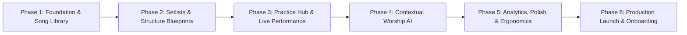
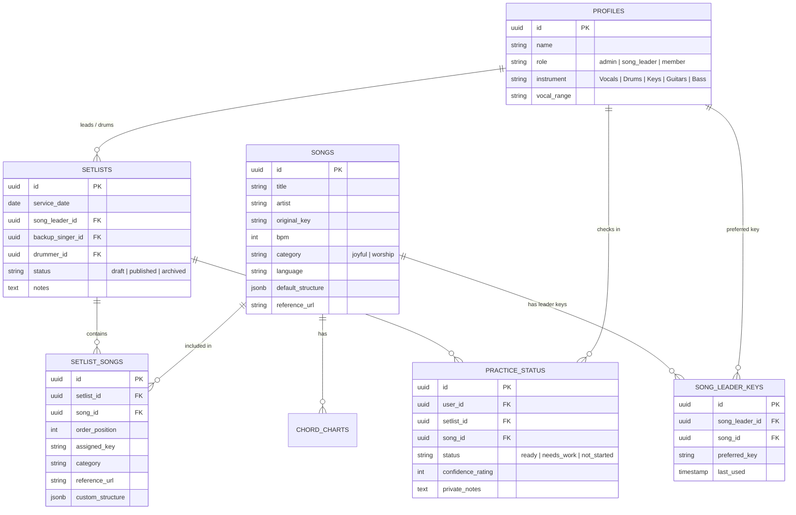

# WorshipFlow — Concept, Problem Space, Feature Specs & Architectural Plan

> **Purpose of this document:** A comprehensive design and product specification detailing the concept, real-world church problems, feature requirements, and architectural plan. This document contains zero implementation status or UI code, serving as a pure blueprint for exploring UX/UI designs, wireframes, and design systems.

---

## 1. High-Level Concept & Context

**WorshipFlow** is a purpose-built system designed specifically for a local church worship ministry. Unlike generic chord-sheet viewers (e.g., OnSong, Ultimate Guitar) or heavyweight administrative church software (e.g., Planning Center), WorshipFlow focuses on the **active weekly cycle of a live church music team**: weekly rotation, at-home preparation, Sunday morning rehearsal, and live Sunday afternoon service execution.

### The Team Profile & Routine
- **Weekly Song Quota:** 4 to 6 songs per service.
  - **Joyful Praise (Fast tempo):** 2 to 3 songs (high energy, groove-driven).
  - **Worship Flow (Slow / Intimate tempo):** 2 to 3 songs (reflective, building dynamics, prayer/communion).
- **Weekly Schedule:**
  - **Monday – Saturday:** Individual practice at home.
  - **Sunday Morning (9:00 AM):** Full band rehearsal and soundcheck.
  - **Sunday Afternoon (2:30 PM):** Live Sunday Worship Service.
- **Team Roster & Rotation:**
  - **Vocals (Rotating):** 5 primary song leaders (France, Maegan, Deanne, Argel, Andrei) who rotate weekly. When not leading, leaders serve as backup vocalists alongside backup-only singers.
  - **Drums (Alternating):** 2 drummers (Aeron and Kyle) who alternate every Sunday.
  - **Fixed Instruments:** Acoustic Guitar (1), Electric/Lead Guitar (1), Keyboard 1 (Main Piano/Pads), Keyboard 2 (Synth/Auxiliary), Bass Guitar (1).

---

## 2. Core Problem Space & Pain Points Solved

### Problem 1: "Key Amnesia" per Song Leader
- **The Issue:** Different vocalists have vastly different vocal ranges (e.g., Soprano vs. Alto vs. Tenor). A song originally recorded in `Ab` might be sung in `G` by France, `E` by Maegan, and `D` by Deanne. Musicians frequently forget who sings what in which key until arriving on Sunday morning, forcing chaotic on-the-spot transpositions and capo re-calculations.
- **The Solution:** Song Leader Key Memory. The system records and remembers every vocalist’s preferred singing key per song and automatically fills it whenever that leader is assigned to a lineup.

### Problem 2: Fractured Practice References
- **The Issue:** When a song is announced, the drummer watches a high-energy live YouTube cover at 130 BPM, the acoustic guitarist listens to a slower Spotify studio album in a different key, and the keyboardist finds an acoustic piano tutorial. When they meet on Sunday at 9:00 AM, everyone is playing different arrangements, tempos, and feels.
- **The Solution:** Unified Pinned Reference Track. Every song in a setlist has one official audio/video reference link pinned by the song leader. All musicians practice with the exact same audio source.

### Problem 3: Arrangement Breakdown During Live Worship
- **The Issue:** Songs in church worship are rarely played strictly start-to-finish like pop songs. Bridges are repeated multiple times, instrumentals swell for prayer, and verses are sometimes skipped. Without visual cues, drummers drop out unexpectedly, vocalists miss entrances, and guitarists play over vocal solos.
- **The Solution:** Song Structure Blueprints. A visual arrangement map (Intro → Verse 1 → Pre-Chorus → Chorus → Bridge x2 → Chorus → Outro) with per-section dynamics (`p`, `cresc`, `f`, `acapella`) and explicit instrument cues (*"Drums drop out"*, *"Keys pad only"*, *"Backup 3rd harmony"*).

### Problem 4: Zero Visibility into Practice Readiness
- **The Issue:** The worship director and song leaders have no idea whether band members actually practiced during the week until the 9:00 AM rehearsal begins, leading to wasted rehearsal time.
- **The Solution:** Home Practice Check-In & Team Readiness Dashboard. Band members mark songs as **Ready**, **Needs Work**, or **Not Started**, add private rehearsal notes, and set reminder alerts. Leaders see an aggregated readiness meter and know exactly which song transitions need work before Sunday morning.

### Problem 5: Live Stage Misalignment
- **The Issue:** During the live service, musicians cannot talk to each other. When a song leader spontaneously loops a bridge or holds an acapella section, band members on opposite sides of the stage get lost.
- **The Solution:** Real-Time Live Performance Sync. A broadcast channel synchronizes the current song and active section across all connected devices on stage. Band members see a giant, high-contrast **NOW** and **NEXT** indicator advance in real time.

### Problem 6: Stage Screen Sleep & Backlight Glare
- **The Issue:** Tablet screens placed on music stands dim and sleep mid-song. Furthermore, bright white backgrounds illuminate musicians' faces and wash out dimmed sanctuary stage lighting.
- **The Solution:** Keep-Screen-Awake (Screen Wake Lock API) and pure OLED Black (`#000000`) high-contrast stage mode.

### Problem 7: Repetitive Song Fatigue & Admin Overhead
- **The Issue:** Worship teams accidentally repeat the same songs too frequently across consecutive weeks, or schedule setlists with jarring key transitions (e.g., jumping from `Eb` to `B`).
- **The Solution:** Intelligent Setlist Analytics and Contextual Worship AI. Warnings for frequently repeated songs, key-flow continuity suggestions, and AI-powered rehearsal briefings.

---

## 3. Detailed Feature Specifications

### Module A: Song Library & Chord Engine
1. **Song Catalog:**
   - Metadata: Title, Artist, Original Key, Tempo (BPM), Category (`joyful` vs `worship`), Language (English / Tagalog / Bilingual), Lyrics.
   - Quick filters: Search by title, lyrics, artist, category, or key.
2. **Chord Chart System:**
   - Chord chart storage with bracketed or inline chord notation.
   - Real-time half-step transposition engine (transposes chords up/down by semitones).
   - Guitar Capo Calculator (calculates capo fret positions and open chord shapes to match target vocal keys).
3. **Song Leader Key History:**
   - Per-vocalist key assignment registry.
   - Semitone shift indicators (e.g., `-3 half steps` / `Capo 3`).
   - Auto-fill integration into setlist creation.

### Module B: Setlist Planning & Scheduling
1. **Setlist Builder:**
   - Multi-song lineup creation with drag-and-drop / position ordering.
   - Service role assignment: Song Leader, Backup Vocalist, Drummer (Kyle vs Aeron).
   - Category validation: Balance tracker ensuring 2–3 Joyful songs and 2–3 Worship songs.
   - Pinned reference track input per song (YouTube / Spotify).
2. **Draft & Published Workflow:**
   - Draft mode for leader experimentation.
   - Publish mode: Triggers push notifications to the team and locks structure to prevent accidental last-minute changes.
   - One-click Setlist Cloning (duplicate previous week's lineup into a new date).
3. **Calendar & Rotation Timeline:**
   - Multi-week schedule grid matching the church calendar.
   - Visual drum rotation indicator (shows whether Aeron or Kyle is scheduled).
   - Archive browser with historical setlist search.

### Module C: Song Structure Blueprints
1. **Section Types:**
   - Supported sections: `Intro`, `Verse`, `Pre-Chorus`, `Chorus`, `Bridge`, `Tag`, `Instrumental`, `Interlude`, `Solo`, `Outro`, `Vamp`.
   - Attributes per section: Bar count (4, 8, 16), Repeat count (`x1`, `x2`, `x3`, `x4`), Key modulation override.
2. **Dynamic Levels & Cues:**
   - `soft` (p / pads only)
   - `building` (cresc / tom swells)
   - `strong` (f / full band groove)
   - `dropping` (dim / sudden drop)
   - `acapella` (vox / hand claps only)
   - `full_band` (full energy)
3. **Per-Section Band Notes:**
   - Instrument-specific cues attached directly to sections (e.g., *"Drums drop on first 4 bars"*, *"Lead guitar solo 8 bars"*, *"Band cut on beat 1"*).
4. **Custom Service Overrides & Structure Lock:**
   - Ability to override a song's default library structure for a specific Sunday without modifying the global blueprint.
   - Structure lock mechanism once a setlist is published, requiring confirmation to modify.

### Module D: Home Practice Hub & Readiness
1. **Individual Practice Dashboard:**
   - Instrument role selector (Drums, Vocals, Backup, Keys 1/2, Guitars, Bass).
   - Countdown to Sunday Morning Rehearsal (9:00 AM).
   - Pinned audio/video practice links and integrated chord sheets.
2. **Readiness Check-In:**
   - 3-state check-in per song: **Ready**, **Needs Work**, **Not Started**.
   - Confidence rating (1 to 5 stars).
   - Private Practice Notes: Confidential musician scratchpad for fingerings, stick choices, and lyric cues.
3. **Team Readiness Dashboard:**
   - Aggregated lineup completion percentage meter.
   - Per-song readiness breakdown identifying weak spots before rehearsal.
   - Musician check-in status grid.
4. **Automated Practice Reminders:**
   - Web Push and in-app alerts for Saturday evening check-ins (7:00 PM) and Sunday morning call times (7:30 AM).

### Module E: Live Performance Mode (Stage Companion)
1. **Live Stage Interface:**
   - Clean, uncluttered UI designed for tablet stands.
   - Giant **NOW** and **NEXT** section indicator cards.
   - High-contrast visual arrangement map showing current active section.
2. **Real-Time Band Synchronization:**
   - Realtime broadcast channel connecting all stage devices.
   - **Leading Mode (Controller):** Advancing a section broadcasts to all devices.
   - **Following Mode (Band):** Screen automatically tracks the leader without manual touches.
3. **Hardware & Navigation Controls:**
   - Bluetooth foot-pedal and keyboard support (`Space`, `Arrows`, `PageUp`/`PageDown`).
   - Song navigation dock with preview of upcoming song and key.
4. **Stage Ergonomics:**
   - Pure OLED Black theme (`#000000`) to prevent stage backlight wash.
   - Large-font toggle for readability from distance.
   - Screen Wake Lock API integration (prevents screen dimming/sleeping during worship).
   - 1-tap floating chord chart and capo sheet overlay (accessible via hotkey `C`).
   - Performance session start/end time logger.

### Module F: Contextual Worship AI (Gemini Integration)
1. **AI Chord Chart Generator:** Converts raw lyrics or song names into formatted chord progressions in the leader's key.
2. **Structure Extraction:** Analyzes reference track arrangements and generates the initial section blueprint.
3. **Smart Key Recommender:** Suggests the optimal singing key based on the assigned leader's vocal range and past setlist history.
4. **Setlist Intelligence & Quality Audits:**
   - Repeat detection (flags songs played within the last 3–4 weeks).
   - Key transition flow analysis (flags awkward semitone clashes between consecutive songs).
   - Category balance checker (verifies 2–3 Joyful and 2–3 Worship distribution).
5. **Sunday Morning Rehearsal Briefing:** Generates a concise bulleted summary for the team: focal points, bridge builds, and transition notes.
6. **Conversational Ministry Assistant:** Context-aware chat with access to the church's song library, leader keys, and service schedules.

---

## 4. Architectural Plan & Project Roadmap

The system is organized into **6 sequential development phases**:

### Phase Breakdown

#### Phase 1: Core Foundation & Song Library
- Responsive application shell and navigation (desktop and mobile PWA).
- Authentication and church user profiles with instrument roles.
- Song database with search, filtering, and categorization (Joyful vs Worship).
- Chord chart engine with manual transposition and guitar capo calculator.

#### Phase 2: Setlist Planning & Song Structure Blueprints
- Setlist creation form with assigned leader, backup, and alternating drum rotation.
- Song picker, position reordering, and key auto-fill from leader history.
- Pinned reference track card and draft/publish workflow.
- Song structure data model (Intro, Verse, Chorus, Bridge, Tag, Outro, Dynamics).
- Visual structure map component and per-section instrument notes editor.
- Custom Sunday structure overrides and published structure lock.
- Song leader key history registry and multi-week rotation calendar.

#### Phase 3: Team Practice Hub & Live Performance Mode
- Individual home practice dashboard with rehearsal countdown and pinned audio references.
- 3-state practice check-in (Ready / Needs Work / Not Started) with private notes.
- Team readiness dashboard for worship leaders.
- Automated practice and rehearsal reminder notifications.
- Live Performance stage view with giant NOW/NEXT section cards.
- Real-time multi-device sync (Leader broadcast vs Follower auto-advance).
- Next/previous song navigation dock and Bluetooth foot-pedal keyboard shortcuts.
- Pure OLED black stage mode and Screen Wake Lock (keep screen awake).
- 1-tap quick chord sheet and capo modal in live mode.
- Live service session duration logger.

#### Phase 4: Contextual Worship AI (Gemini Integration)
- Gemini API integration with worship domain system prompts.
- AI chord chart generation and structure extraction from reference tracks.
- Smart key recommendation engine based on vocal range.
- Setlist intelligence warnings (repeat detector, key flow, balance check).
- Automated Sunday morning rehearsal briefing generator.
- Ministry AI chat assistant with team roster context.

#### Phase 5: Analytics, Polish & Ergonomics
- Historical song frequency statistics and leader usage analytics.
- Visual setlist intelligence audit banner in the builder.
- Design polish: micro-animations, touch target optimization, and dark mode refinement.
- App settings, accessibility compliance (ARIA labels, keyboard navigation), and offline PWA fallbacks.

#### Phase 6: Production Launch & Onboarding
- Production deployment configuration and environment setup.
- Song library bulk seed utility.
- First-time team onboarding wizard for new musicians.
- Sunday trial feedback refinement, documentation, and v1.0 release.

---

## 5. Entity Relationship Model (Data Specs)

---

## 6. Guidelines for UI/UX & Design Exploration

When exploring wireframes, layouts, visual directions, or design systems for WorshipFlow, keep these ergonomic guidelines in mind:

1. **Stage Distance Legibility:** During live services and rehearsals, screens sit on music stands 2 to 4 feet away from musicians. Primary keys, current section names, and BPM must be legible at a glance.
2. **Zero Light Pollution (Dark Mode):** Live worship sanctuaries often dim house lights and rely on stage lighting washes. White backgrounds create distracting upward facial lighting. Pure black (`#000000`) surfaces with subdued borders and vibrant accent badges are essential.
3. **Fast Tap Targets for Mobile/Tablet:** Musicians frequently tap buttons with a single hand while holding an instrument or guitar pick. Tap targets for section advance, chords quick-view, and check-in buttons should be minimum 44x44px.
4. **Distinction between Joyful and Worship:** Joyful praise and slow worship are distinct liturgical modes. Use consistent visual distinction (e.g., warm amber/orange for Joyful, calm blue/indigo for Worship) across setlists, library, and performance views.
5. **No Clutter During Performance:** When a musician enters Performance Mode, all administrative controls, form fields, and extraneous navigation must melt away, leaving only **Song Title, Key, Now Section, Next Section, and Arrangement Flow**.
